<div align="center">

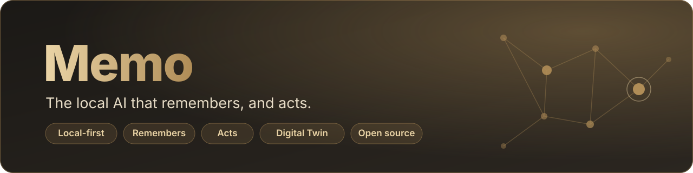

<br/>

### Every other AI forgets you the moment you close the tab. Memo doesn't.

<sub>Runs on **your** machine · remembers weeks of conversation · gets ready before you ask · and actually **does** things.</sub>

<br/><br/>

<a href="https://memocpp.com"></a>
<a href="https://memocpp.com/guide"></a>
<a href="https://github.com/BugraAkdemir/memo/releases"></a>
<a href="https://github.com/BugraAkdemir/memo/stargazers"></a>


<br/>


<a href="https://github.com/BugraAkdemir/memo/actions"></a>

<br/><br/>

<b>
<a href="#whats-new-in-v50">What's new</a> &nbsp;·&nbsp;
<a href="#features">Features</a> &nbsp;·&nbsp;
<a href="#digital-twin--mail">Digital Twin</a> &nbsp;·&nbsp;
<a href="#privacy-and-security">Privacy</a> &nbsp;·&nbsp;
<a href="#quick-start">Install</a> &nbsp;·&nbsp;
<a href="#architecture">Architecture</a> &nbsp;·&nbsp;
<a href="#documentation">Docs</a>
</b>

<p><b><a href="READmeTR.md">🇹🇷 Türkçe için tıkla</a></b></p>

<br/>

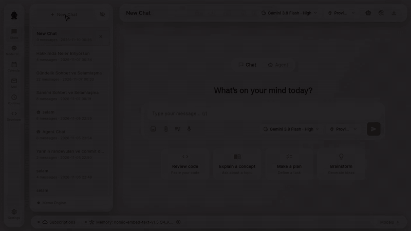

<p><sub>A real recording with a real model, nothing staged · <a href="https://raw.githubusercontent.com/BugraAkdemir/memo/main/docs/assets/videos/memo-demo-en.mp4">▶ Watch with voice-over (61 s)</a></sub></p>

</div>

> [!NOTE]
> **v5.0.0 is out** (November 7, 2026). Read the [release notes](versinNote/v5.0.0.md) or jump to [what's new](#whats-new-in-v50).

---

## Why Memo

It runs entirely on **your** machine. It remembers conversations from weeks ago. It learns *when* you work and quietly gets ready before you do. And when you ask it to actually **do** something (edit a file, run a command, answer a mail, message someone on WhatsApp) it does it, asking first.

<table>
<tr>
<td align="center" width="25%">
  <h3>🧠 Remembers</h3>
  <p>Every chat is embedded into a local vector database. Mention a project from three weeks ago and the context is already there.</p>
  <sub><a href="#chat-and-memory">How →</a></sub>
</td>
<td align="center" width="25%">
  <h3>📊 Learns</h3>
  <p>A background observer learns your rhythms (never your words) and anticipates when you code, plan or rest.</p>
  <sub><a href="#channels-calendar-and-proactivity">How →</a></sub>
</td>
<td align="center" width="25%">
  <h3>⚡ Acts</h3>
  <p>Dozens of tools in a permission-gated sandbox: files, shell, web, WhatsApp, calendar. You approve each step.</p>
  <sub><a href="#the-agent">How →</a></sub>
</td>
<td align="center" width="25%">
  <h3>✉️ Handles your mail</h3>
  <p>Reads, protects, drafts in your own style and sends nothing without your say-so. Off until you switch it on.</p>
  <sub><a href="#digital-twin--mail">How →</a></sub>
</td>
</tr>
</table>

<div align="center">

|  | 🤖 Typical AI assistant | 🧠 **Memo** |
|---|:---:|:---:|
| **Memory** | Forgets when the tab closes | Remembers for **weeks** (local RAG) |
| **Your data** | Sent to the cloud | Stays on **your machine**¹ |
| **Works offline** | ❌ | ✅ with a local model |
| **Takes real actions** | Generates text only | Edits files, runs commands, sends messages |
| **Learns your habits** | ❌ | ✅ proactive engine, opt-in |
| **Cost** | Monthly subscription | **Free & open source** (AGPL-3.0) |

<sub>¹ Cloud providers are optional and only used if you add one. Official builds also send a tiny, anonymous daily usage summary with **no content** in it. <a href="#privacy-and-security">Details and the off switch →</a></sub>

</div>

---

## What's new in v5.0

<table>
<tr>
<td width="33%" valign="top">

**✉️ Mail & Digital Twin**<br/>
Gmail, Outlook or any IMAP account. Injection shield, secret scan, replies in your style, approval and undo window.<br/>
<sub><a href="docs/DIGITAL_TWIN_AND_MAIL.md">Docs →</a></sub>

</td>
<td width="33%" valign="top">

**🌅 Daily briefing**<br/>
Your morning in one card, sent to the app, Telegram, WhatsApp or mail. You pick the time, content and model.<br/>
<sub><a href="docs/DIGITAL_TWIN_AND_MAIL.md">Docs →</a></sub>

</td>
<td width="33%" valign="top">

**🧭 New setup wizard**<br/>
Model, memory, mail, channels, briefing and privacy in one guided flow that resumes where you left off.<br/>
<sub><a href="docs/SETUP_WIZARD.md">Docs →</a></sub>

</td>
</tr>
<tr>
<td valign="top">

**📁 Projects**<br/>
Open a folder and it gets its own rules and its own memory; your personal memory never reaches it.<br/>
<sub><a href="docs/PROJECT_FOLDER.md">Docs →</a></sub>

</td>
<td valign="top">

**🧩 Sub-agents & skills**<br/>
Hand work to background sub-agents; call a skill by name with <code>/skill</code> in your message.<br/>
<sub><a href="docs/CHAT_SUBAGENTS.md">Docs →</a></sub>

</td>
<td valign="top">

**⚡ Faster local models**<br/>
Engine chosen by the GPU Memo really sees, Vulkan prompt processing, n-gram speculative decoding (Linux).<br/>
<sub><a href="versinNote/v5.0.0.md">Notes →</a></sub>

</td>
</tr>
<tr>
<td valign="top">

**👀 Live agent**<br/>
Text, thinking and tool calls stream in order while the agent works, and long turns keep the task.

</td>
<td valign="top">

**🗂 One chat list**<br/>
The Agent tab is gone: one list, a Chat | Agent start screen, agent chats marked with a robot.

</td>
<td valign="top">

**🔄 Updates itself**<br/>
Signed updates from inside the app, with automatic rollback if the new version doesn't start.<br/>
<sub><a href="docs/AUTO_UPDATE.md">Docs →</a></sub>

</td>
</tr>
</table>

---

## Features

### Chat and Memory

<table>
<tr>
<td width="62%">

**A chat that feels alive.** Token-by-token streaming with full Markdown: highlighted code, tables, images. Drop in a file (text, PDF, code) or an image. Hit `/` for the palette (installed skills plus `/remember`, `/forget`, `/model`, `/orchestra`) or hold the mic for **on-device** voice input via whisper.cpp. Toggle web search and replies are enriched with live results, with no API key.

**Immortal RAG memory.** Every exchange is embedded into a 768-dimension vector and stored in SQLite with `sqlite-vec` ANN indexing plus FTS5. Ask something new and Memo injects the most relevant past conversations, so the model already knows. No Pinecone, no embeddings API, no cloud vector database.

</td>
<td align="center" width="38%">
  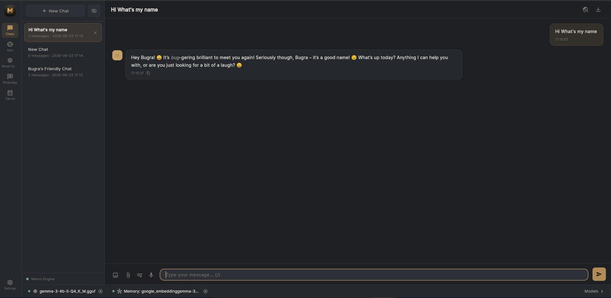
  <br/><br/>
  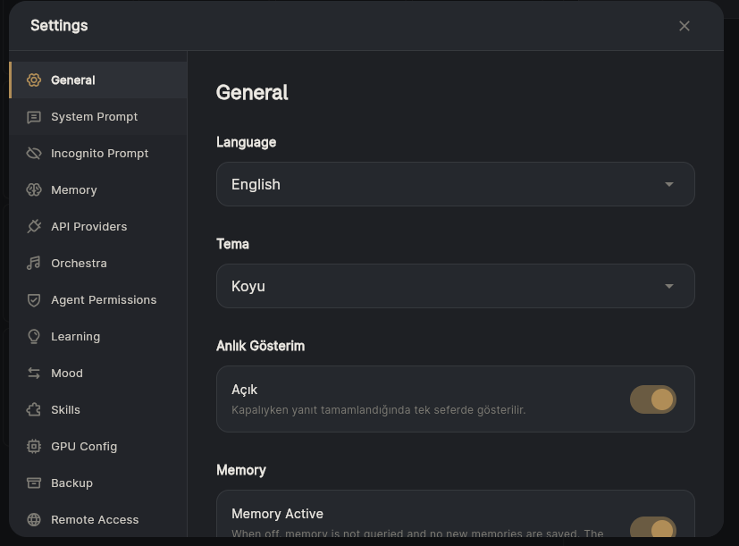
</td>
</tr>
</table>

<div align="center">
  <video src="https://raw.githubusercontent.com/BugraAkdemir/memo/main/docs/assets/videos/whats-my-name.mp4" controls width="80%"></video>
  <p><sub>Memo recalling who you are across sessions · <a href="https://raw.githubusercontent.com/BugraAkdemir/memo/main/docs/assets/videos/whats-my-name.mp4">▶ open the video</a></sub></p>
</div>

<details>
<summary><b>📁 Projects: a memory of their own</b></summary>
<br/>

Pick a folder for an agent chat and Memo asks once: *Set up*, *Not now* or *Never for this folder*. Nothing is written unless you say *Set up*.

- **What gets created:** a small `.memo/` folder (generic working rules, notes, settings) plus an `AGENTS.md` and `handoff.md` in the project root, never over a file you already have.
- **Its own memory:** a project chat reads and writes only **its own project's** memory. It **never** receives your general memory, pinned facts, name, style notes or persona.
- **Project skills and permissions:** add instructions-only skills per project; pre-approve command prefixes in `.memo/permissions.json`, honoured only after **you** approve the file on this device.
- Your home folder, Memo's own folders and system folders can never be a project.

→ [Project folders](docs/PROJECT_FOLDER.md)

</details>

---

### The Agent

<table>
<tr>
<td width="58%">

Point Memo at a project folder and it stops talking and starts **doing**: reading, writing and editing files, listing directories, running shell commands, searching and fetching the web. **Over 40 built-in tools** run inside a sandbox with path validation, symlink protection and a command blacklist.

Every tool call asks first. Allow or deny **once, for the session, or forever**. Watch it work live: the model's words, its thinking and each tool call stream in order, grouped ("Ran 3 commands") and expandable. Stopping an answer keeps what you already saw.

**Code Mode has three gears:** Plan / Auto / Build, cycled with **Ctrl+Tab**. Plan investigates and writes a saved plan without touching a file; Auto asks before each edit; Build runs without waiting.

**Sub-agents** take bounded jobs in the background while you keep talking. Each gets only its task, the coding rules and the skills picked for it, never your personal memory. Parallel writers each work in their own copy of the project and are merged one at a time.

**Self-Driving task loop:** hand it a `Task.md` checklist and walk away. Planner/executor mode with plan approval, parallel sub-agents, escalating retry, and a chat or push notification on every outcome.

</td>
<td align="center" width="42%">
  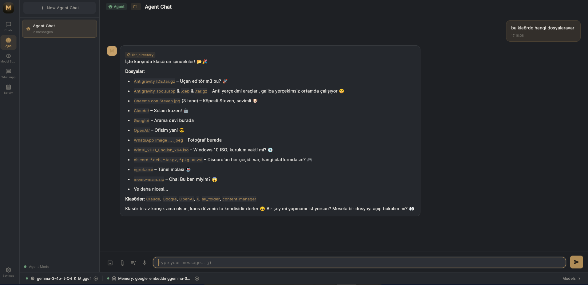
</td>
</tr>
</table>

<div align="center">
  <video src="https://raw.githubusercontent.com/BugraAkdemir/memo/main/docs/assets/videos/agent.mp4" controls width="80%"></video>
  <p><sub>Reading files, running commands, writing code: live, sandboxed, permission-gated · <a href="https://raw.githubusercontent.com/BugraAkdemir/memo/main/docs/assets/videos/agent.mp4">▶ open the video</a></sub></p>
</div>

→ [Sub-agents](docs/CHAT_SUBAGENTS.md) · [Features catalog](docs/FEATURES.md)

---

### Digital Twin & Mail

> [!IMPORTANT]
> Everything here is **off by default.** Nothing is read, drafted or sent until you switch it on, one switch at a time.

<table>
<tr>
<td width="55%" valign="top">

- **Connect in one click.** Gmail and Outlook via OAuth (no app passwords); any other provider through IMAP/SMTP with auto-discovered settings. Credentials stay encrypted on your machine.
- **Inbox protection.** Three layers decide what a message is: structured data and your contacts first, then standard mail headers, and a model only for what's left. Newsletters, bulk mail and one-time-code mails never enter memory or get a reply.
- **A shield against prompt injection.** A mail that tries to order the assistant around ("ignore your instructions", "send me your `.env`", encoded commands, in English or Turkish) is stopped before any model reads it, and stays readable in your inbox.
- **Nothing secret leaves.** Subject, body and recipients are scanned for API keys, private keys, `KEY=value` lines and recent one-time codes before any send or draft.
- **Replies in your style.** From your last sent messages Memo learns how you write, researches read-only (for example a project's real git state), drafts the reply and uploads it to your Drafts folder for review.
- **You stay in charge.** Approve from the app, or from WhatsApp and Telegram with `#onay N` / `#iptal N` / `#asla N`. *Full auto* is per person, with a 60-second undo window, an independent confidence score and rate limits.
- **Calendar-aware.** Invitations land on your calendar with conflicts flagged and alternatives offered, without revealing your other events.
- **Follow-up radar** for answers you're waiting on and promises you made.

</td>
<td width="45%" valign="top">

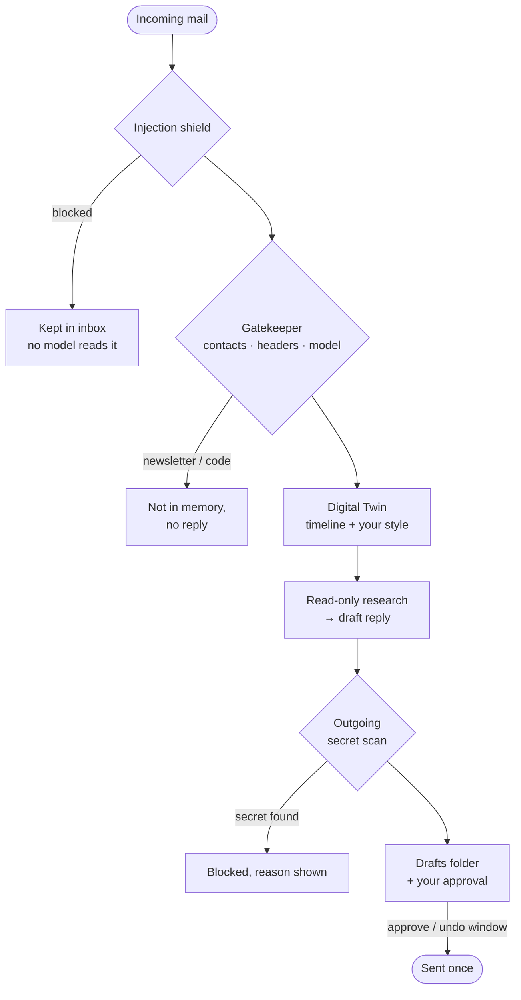

</td>
</tr>
</table>

**🌅 Daily briefing.** Today's meetings, what was prepared overnight, drafts waiting, overdue replies, promises due and unfinished code, in one card built from your own data. Choose any half hour, any mix of sections, up to five custom items, and where it goes: the app always, plus Telegram, WhatsApp (your own number) and/or mail (your own address). An optional separate briefing model writes the summary. Each send is claimed first, so a restart can never send it twice.

→ [Mail & Digital Twin overview](docs/DIGITAL_TWIN_AND_MAIL.md) · [Mail security](docs/MAIL_SECURITY.md) · [Approval & undo](docs/DIGITAL_TWIN_APPROVAL.md)

---

### Channels, Calendar and Proactivity

<table>
<tr>
<td width="58%">

**📱 WhatsApp & Telegram.** Connect WhatsApp with a QR code (same protocol as WhatsApp Web, **no Business API fees**) or a Telegram bot token. Read, search and reply inside Memo; say *"message Berra"* and the agent resolves the contact. **Message yourself and Memo answers**, with chat, memory and agent tools, no need to open the app. Send and receive pictures, and ask for a **routine** in plain language.

</td>
<td align="center" width="42%">
  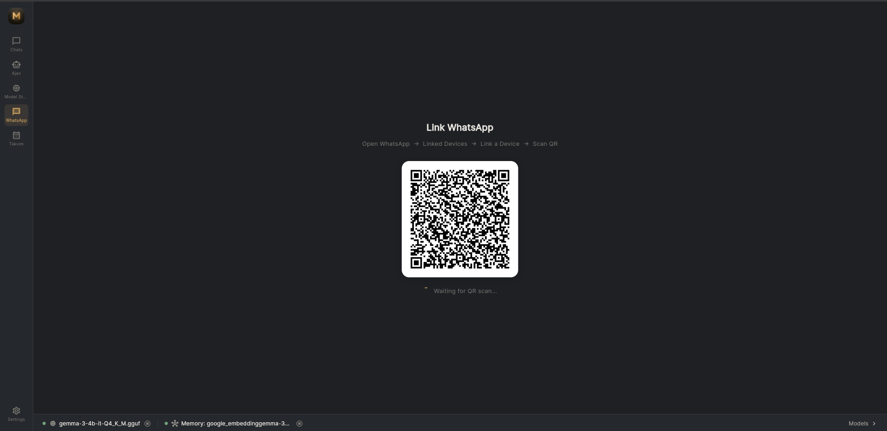
</td>
</tr>
<tr>
<td width="58%">

**📅 A calendar that schedules itself.** A two-stage pipeline scans messages for time patterns ("tomorrow", "next Tuesday", "at 3pm"), and only matches reach an LLM that extracts a structured event. Vague plans become ambiguity events you confirm with one tap. Reminders never fire twice.

</td>
<td align="center" width="42%">
  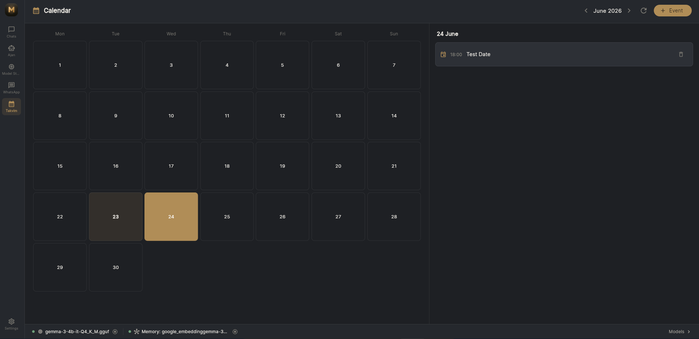
</td>
</tr>
</table>

**👁 Proactive learning engine.** A background observer tracks *when* you're active, never what you say. With circular statistics it finds rhythms like *"Mondays 9–10am, planning"*. When confidence crosses a threshold it suggests something, notifies you, or at high confidence starts the agent. It's opt-in, and it stores **only topic labels and timestamps, never your raw text.**

**🐾 A desktop mascot that shows its work.** A small always-on-top character mirrors what Memo is doing in real time from any channel, with a plain-language status bubble that never shows the model's reply text.

<div align="center">
  <video src="https://raw.githubusercontent.com/BugraAkdemir/memo/main/docs/assets/videos/calendar.mp4" controls width="80%"></video>
  <p><sub>A plan mentioned in chat becomes a calendar event · <a href="https://raw.githubusercontent.com/BugraAkdemir/memo/main/docs/assets/videos/calendar.mp4">▶ open the video</a></sub></p>
</div>

---

### Models and Providers

<table>
<tr>
<td width="62%">

**🏪 A curated model store.** Memo detects your GPU and RAM and tags every download with a **hardware-fit badge** ("Fits your device", "Runs (CPU)", "Too large"). Plain-language quality labels replace quant codes, with capability filters and a one-click Start that configures GPU offloading.

**⚡ Local models, faster.** Memo asks each bundled engine which GPUs it sees and picks accordingly. With a Vulkan driver, prompt processing was about **2.2× faster** in our test, and code-heavy replies up to **3× faster** with n-gram speculative decoding. Measured on one model and one machine; Linux for now ([details](versinNote/v5.0.0.md)).

</td>
<td align="center" width="38%">
  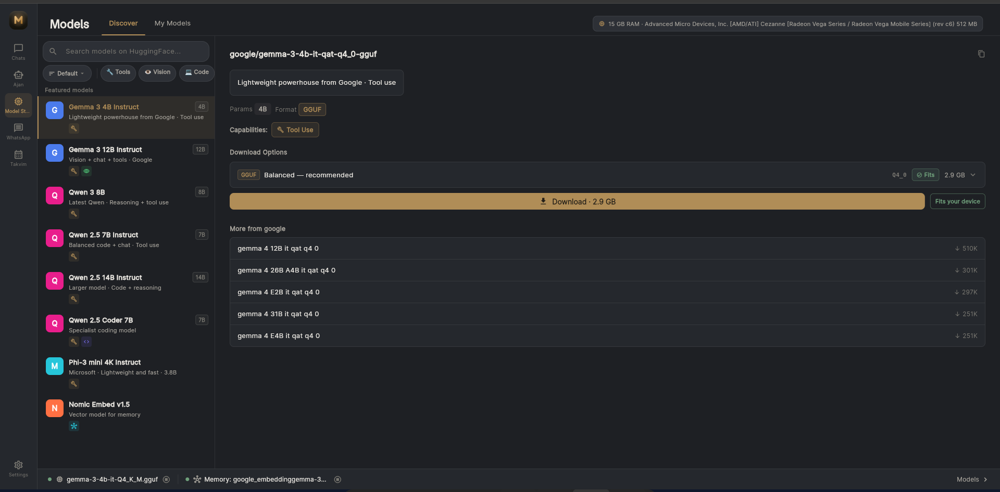
  <br/><br/>
  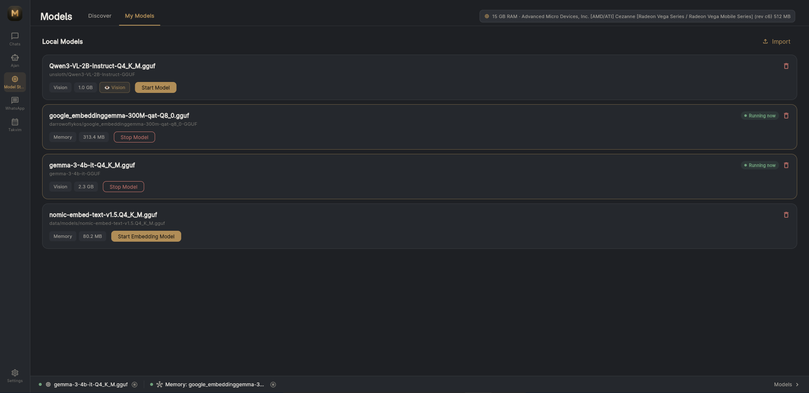
</td>
</tr>
</table>

- **18 provider types, one interface:** OpenAI, Claude, Gemini, Grok, Groq, OpenRouter, Ollama, bundled `llama.cpp`, OpenAI- and Anthropic-compatible custom endpoints, OpenCode Zen and Go, Kilo Code, Cline, plus **Subscriptions**: sign in once with an Antigravity, Claude or Codex account and every model it offers appears in the selector, `/model` and the local `/v1` gateway, with no API key. Auto-fallback, auto-disable after 3 errors, live switching mid-chat, keys encrypted with AES-256-GCM.
- **🖥 Coding agents as providers (Beta):** point a chat at your installed **Claude Code** or **Codex CLI**. **ChatGPT and claude.ai (Beta)** can be driven through a real browser window instead of spending API quota.
- **🎵 Orchestra:** a Chief model splits a complex task across specialist roles (planner, frontend, backend, bug fixer, reviewer, security, DevOps, generalist) and mixes providers freely.
- **🎤 Live Mode v2:** native audio-to-audio conversation through Google Live or OpenAI Realtime, with barge-in and memory recall; falls back to on-device whisper.cpp plus local Piper TTS.

---

### Privacy and Security

- **Local-first.** Config files are `0600`; Incognito mode leaves no trace; the observer stores timestamps, never message content; both local gateway endpoints require their key for any non-loopback caller; imported skills never activate themselves.
- **Mail is hostile text.** Deterministic injection checks, an optional second review that fails closed, a tool-limited research assistant and an outgoing secret scan ([details](docs/MAIL_SECURITY.md)).
- **Signed updates.** Every download is checked against a manifest signed by the maintainer; a mismatch is deleted and nothing is installed.
- **Cloud sync is optional and encrypted before upload:** Google Drive backup with AES-256-GCM and PBKDF2 (600K iterations).
- **Anonymous daily summary, on by default in official builds.** A random install ID, version, system, hardware class, usage counts and error classes, and **never** messages, memory, contacts, files, paths, keys or names. It also applies when you update from a version that had no such feature. Turn it off in the setup wizard or **Settings → Privacy**; source builds send nothing unless you turn it on. Run `memo telemetry preview` to see exactly what would be sent ([what's collected](docs/TELEMETRY.md)).

---

## Quick Start

**No terminal skills needed. `llama.cpp` and the engine binaries are bundled.**

| Platform | One-line install |
|----------|------------------|
| **Linux / macOS** | `curl -fsSL https://data.memocpp.com/get-memo.sh \| bash` |
| **Windows** | `irm https://data.memocpp.com/get-memo.ps1 \| iex` |

The first launch opens the **setup wizard**: connect a model (local, API key or subscription), pick an embedding model, and optionally mail, channels and the daily briefing. Required steps are starred and it resumes where you left off.

<details>
<summary><b>📦 What the installer does</b></summary>
<br/>

- Installs the `memo` CLI on your PATH and the Flutter desktop app (find **Memo** in your app menu)
- Copies the engine binaries (`llama-server`, `vec0`), GPU-ready
- Seeds default configs and never overwrites your settings; safe to re-run

</details>

<details>
<summary><b>🔄 Update, uninstall, manual download</b></summary>
<br/>

Memo can **update itself** from inside the app. Versions up to 4.6.0 have no updater, so moving from one of those is a single manual update (re-run the installer); after that, updates are one click.

```bash
curl -fsSL https://data.memocpp.com/update.sh | bash      # update
curl -fsSL https://data.memocpp.com/uninstall.sh | bash   # uninstall (optionally backs up memory)
```

Or download a release from **[memocpp.com](https://memocpp.com)**:

| Platform | Instructions |
|----------|-------------|
| **Linux** | `tar xzf memo.tar.gz -d Memo && cd Memo && ./run_memo.sh` |
| **Windows** | Run `Memo-Setup.exe` |
| **macOS** | `unzip memo-mac.zip -d Memo && cd Memo && ./run_memo.sh` |

[](https://github.com/BugraAkdemir/memo/actions/workflows/build-linux.yml)
[](https://github.com/BugraAkdemir/memo/actions/workflows/build-windows.yml)
[](https://github.com/BugraAkdemir/memo/actions/workflows/build-macos.yml)

</details>

<details>
<summary><b>🏠 Self-hosting: Raspberry Pi, home server, VPS (no desktop app)</b></summary>
<br/>

Run Memo 24/7 on its own box and reach it from the desktop or mobile app. No Flutter GUI is installed on the machine itself.

```bash
# Native install (Linux x86_64/arm64, Raspberry Pi included, or macOS)
curl -fsSL https://data.memocpp.com/get-memo-server.sh | bash

# Or Docker / CasaOS (multi-arch: amd64 + arm64)
docker compose -f docker/docker-compose.yml up -d     # see docker/README.md

memo service install --lan   # systemd --user service, auto-restart, LAN-reachable
memo remote status           # auth mode, addresses, warnings
memo config get llama.port   # edit config.yaml from the command line
```

Four auth modes (open / token / password / token+password) with per-device tokens you can revoke individually. New pieces land on `main` first; use `get-memo-server-beta.sh` for the newest. See [Self-Hosting](docs/SELF_HOSTED.md).

</details>

<details>
<summary><b>🛠 For developers: build from source</b></summary>
<br/>

**Prerequisites:** Go 1.26+ · Flutter 3.10+ · SQLite dev libraries (for CGO)

```bash
git clone https://github.com/BugraAkdemir/memo.git && cd memo

# Terminal 1: backend
CGO_ENABLED=1 go run -tags "sqlite_fts5" . --port 8090

# Terminal 2: frontend
cd frontend && flutter run -d linux
```

Verification (what CI runs): `CGO_ENABLED=1 go test -tags "sqlite_fts5" ./... -race`, then `cd frontend && flutter analyze lib/ && flutter test`. Release packages: `./build_releases.sh` (Linux) or `.\scripts\build_releases.bat` (Windows).

</details>

---

## Architecture

Two decoupled processes talk over plain HTTP and SSE on `localhost:8090`. The Go backend is a headless REST API (pure `net/http`, every route also served under `/api/v1/`); the Flutter app is a single client for every platform.

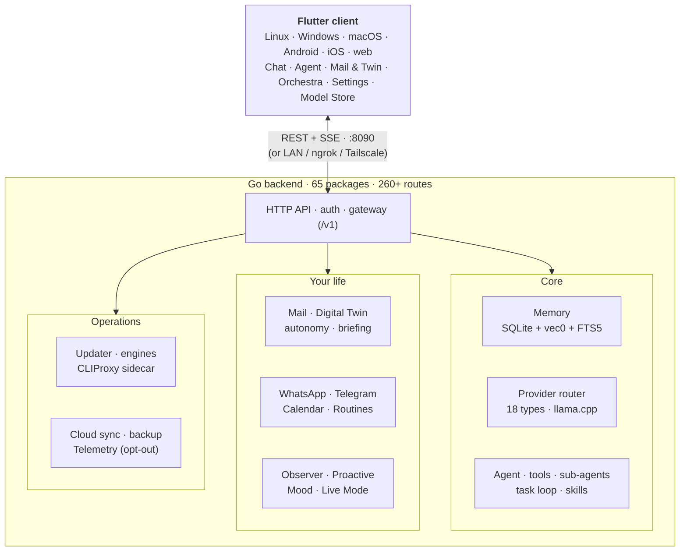

| | | | |
|---|---|---|---|
| **Backend** Go 1.26 | **Frontend** Flutter 3.10 | **Vector DB** SQLite + vec0 | **Inference** llama.cpp |
| **State** Riverpod 2.4 | **HTTP** Dio 5.4 / SSE | **Voice** whisper.cpp · Piper | **WhatsApp** whatsmeow |
| **Cloud** Drive + AES-256 | **GPU** NVIDIA / ROCm / Vulkan | **License** AGPL v3 | **CI** GitHub Actions |

---

## Documentation

| Start here | Go deeper |
|---|---|
| 📚 [Documentation index](docs/DOCS.md) | 🏗 [Architecture](docs/architecture.md) · [Project map](docs/PROJECT_MAP.md) |
| ✨ [Features catalog](docs/FEATURES.md) · [UI features](docs/UI_FEATURES.md) | 🔌 [API reference](docs/API_REFERENCE.md) |
| ✉️ [Mail & Digital Twin](docs/DIGITAL_TWIN_AND_MAIL.md) · [Setup wizard](docs/SETUP_WIZARD.md) | 🔒 [Mail security](docs/MAIL_SECURITY.md) · [Telemetry](docs/TELEMETRY.md) |
| 📁 [Project folders](docs/PROJECT_FOLDER.md) · [Sub-agents](docs/CHAT_SUBAGENTS.md) | 🔄 [Auto-update](docs/AUTO_UPDATE.md) · [Self-hosting](docs/SELF_HOSTED.md) |
| 🛣 [Roadmap](docs/ROADMAP.md) · [Known issues](docs/KNOWN_ISSUES.md) | 🎨 [Design system](frontend/DESIGN.md) · [Release notes](versinNote/v5.0.0.md) |

Prefer a browsable knowledge base? Open **`obsidian-doc-en/Memo`** (English) or **`obsidian-doc/Memo`** (Türkçe) as an [Obsidian](https://obsidian.md) vault. Full guide: [memocpp.com/guide](https://memocpp.com/guide).

---

## Contributing

Memo is **AGPL-3.0** and contributions are welcome.

- 🛣 Browse the [Roadmap](docs/ROADMAP.md) for what's planned
- 🐛 Pick a [Known Issue](docs/KNOWN_ISSUES.md) as a good first task
- 📖 Read [CONTRIBUTING](docs/CONTRIBUTING.md) and the working rules in [`AGENTS.md`](AGENTS.md)
- 💡 Float an idea in [Discussions](https://github.com/BugraAkdemir/memo/discussions)

---

<div align="center">
  <br/>
  <h3>Your mind. Your data. Your machine.</h3>
  <p>Built with obsession by <a href="https://github.com/BugraAkdemir">Buğra Akdemir</a></p>
  <br/>
  <a href="https://memocpp.com"></a>
  &nbsp;
  <a href="https://github.com/BugraAkdemir/memo/stargazers"></a>
  <br/><br/>
  <sub><a href="https://github.com/BugraAkdemir/memo/issues">Bug report</a> · <a href="https://github.com/BugraAkdemir/memo/discussions">Discussion</a> · <a href="READmeTR.md">Türkçe</a></sub>
</div>
