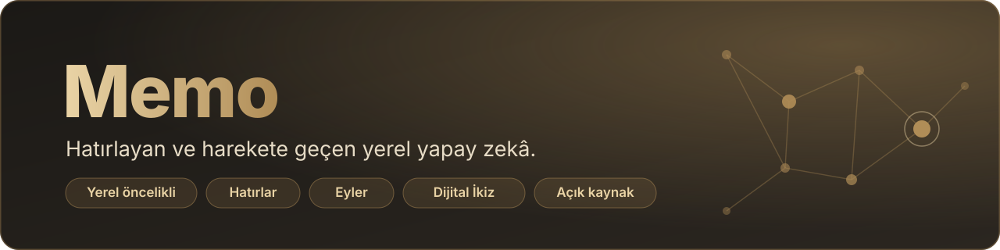
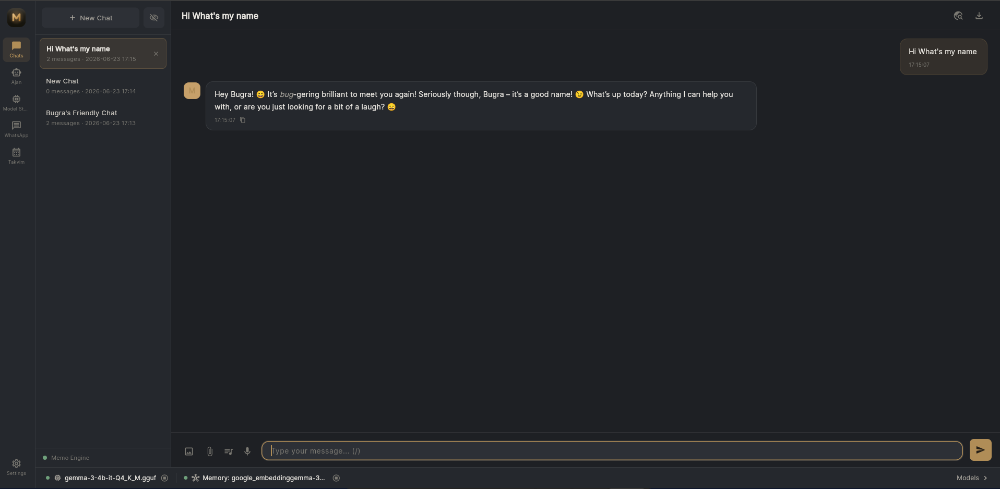
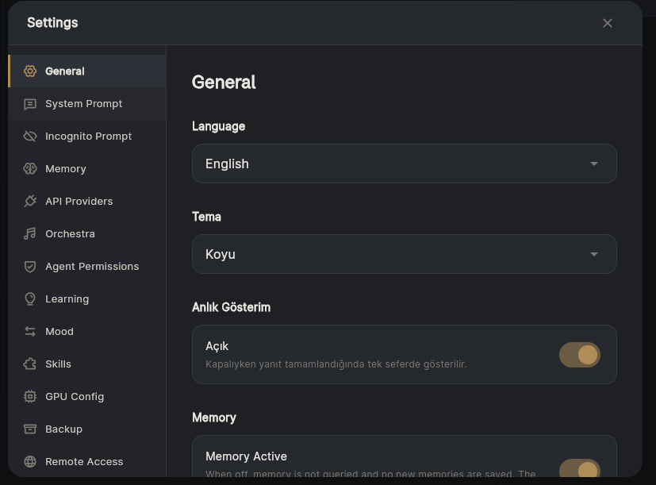
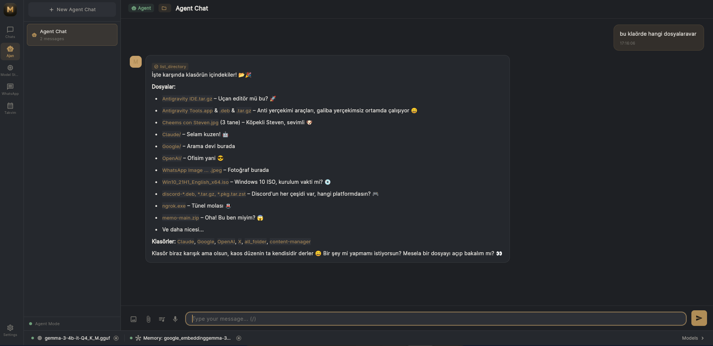
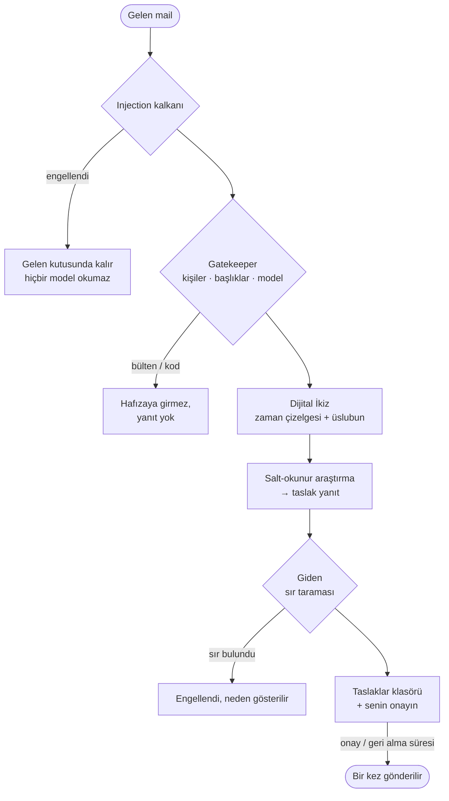
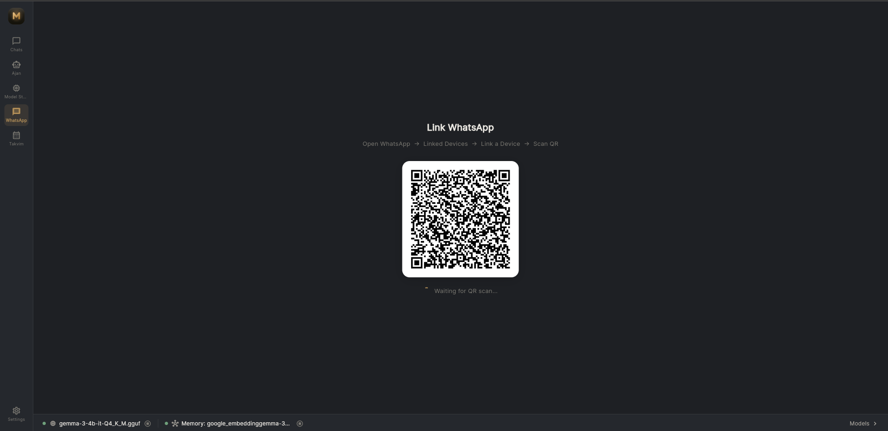
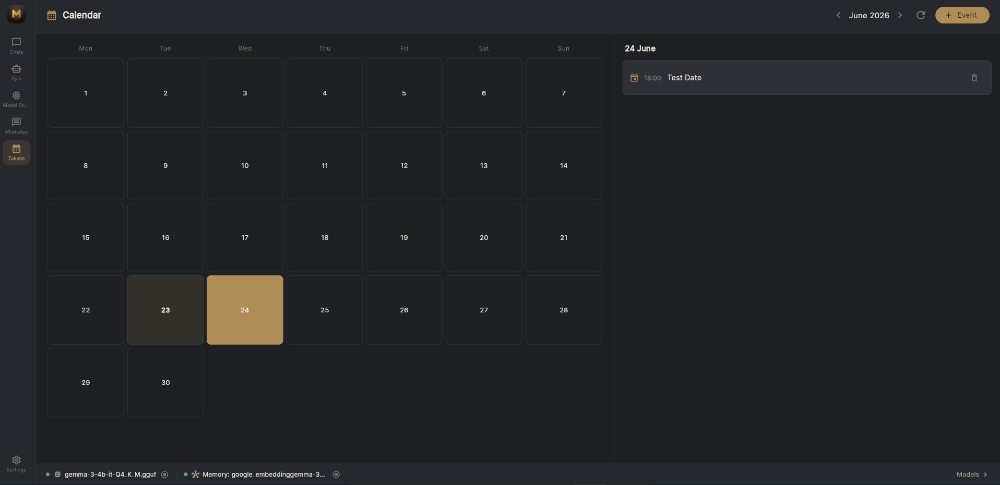
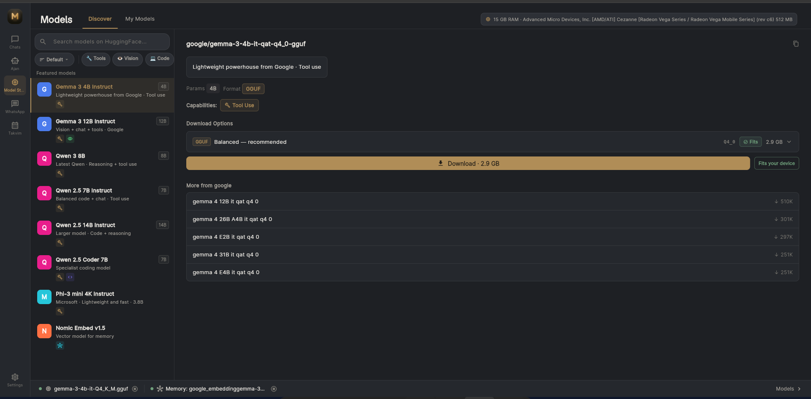
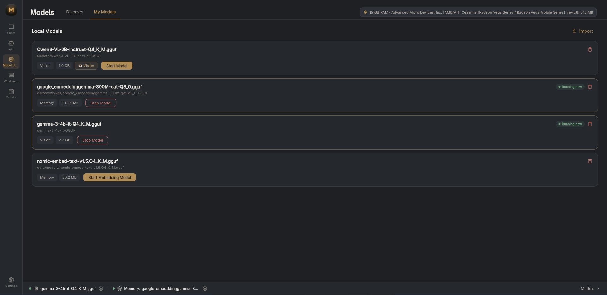
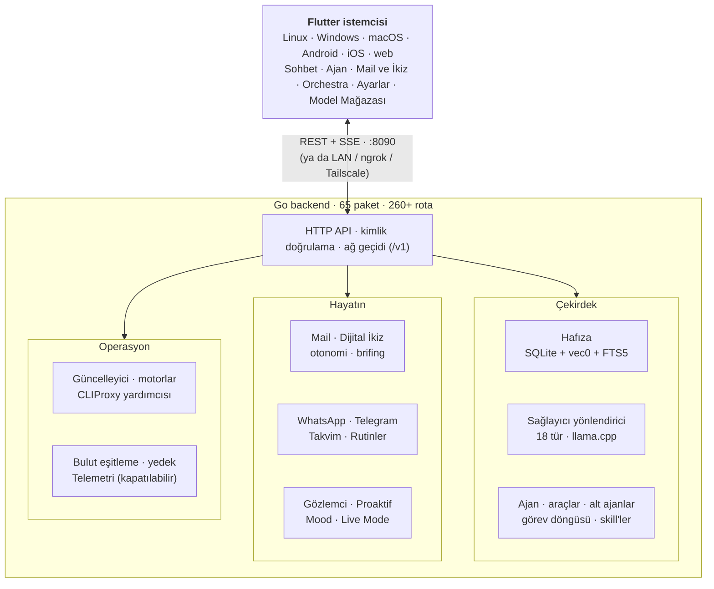

<div align="center">



<br/>

### Diğer her yapay zekâ, sekmeyi kapattığın an seni unutur. Memo unutmaz.

<sub>**Senin** makinende çalışır · haftalarca konuşmayı hatırlar · sen sormadan hazırlanır · ve gerçekten bir şeyler **yapar**.</sub>

<br/><br/>

<a href="https://memocpp.com"></a>
<a href="https://memocpp.com/tr/guide"></a>
<a href="https://github.com/BugraAkdemir/memo/releases"></a>
<a href="https://github.com/BugraAkdemir/memo/stargazers"></a>


<br/>


<a href="https://github.com/BugraAkdemir/memo/actions"></a>

<br/><br/>

<b>
<a href="#yenilikler">Yenilikler</a> &nbsp;·&nbsp;
<a href="#ozellikler">Özellikler</a> &nbsp;·&nbsp;
<a href="#ikiz">Dijital İkiz</a> &nbsp;·&nbsp;
<a href="#gizlilik">Gizlilik</a> &nbsp;·&nbsp;
<a href="#kurulum">Kurulum</a> &nbsp;·&nbsp;
<a href="#mimari">Mimari</a> &nbsp;·&nbsp;
<a href="#dokumantasyon">Dokümantasyon</a>
</b>

<p><b><a href="README.md">🇬🇧 Click for English</a></b></p>

</div>

> [!NOTE]
> **v5.0.0 yayında** (7 Kasım 2026). [Sürüm notlarını](versinNote/tr/v5.0.0.md) oku ya da [yeniliklere](#yenilikler) geç.

---

## Neden Memo

Tamamen **senin** makinende çalışır. Haftalar önceki konuşmaları hatırlar. *Ne zaman* çalıştığını öğrenir ve sen daha başlamadan sessizce hazırlanır. Gerçekten bir şey **yapmasını** istediğinde (dosya düzenlemek, komut çalıştırmak, bir maile yanıt vermek, WhatsApp'ta birine yazmak) yapar, önce de sorar.

<table>
<tr>
<td align="center" width="25%">
  <h3>🧠 Hatırlar</h3>
  <p>Her sohbet yerel bir vektör veritabanına gömülür. Üç hafta önceki bir projeden söz et; bağlam zaten hazır.</p>
  <sub><a href="#sohbet">Nasıl →</a></sub>
</td>
<td align="center" width="25%">
  <h3>📊 Öğrenir</h3>
  <p>Arka plandaki gözlemci ritmini öğrenir (sözlerini asla) ve ne zaman kod yazdığını, plan yaptığını ya da dinlendiğini öngörür.</p>
  <sub><a href="#kanallar">Nasıl →</a></sub>
</td>
<td align="center" width="25%">
  <h3>⚡ Eyler</h3>
  <p>İzin kapılı bir sandbox'ta onlarca araç: dosyalar, shell, web, WhatsApp, takvim. Her adımı sen onaylarsın.</p>
  <sub><a href="#ajan">Nasıl →</a></sub>
</td>
<td align="center" width="25%">
  <h3>✉️ Mailini yönetir</h3>
  <p>Okur, korur, senin üslubunla taslak yazar ve sen söylemeden hiçbir şey göndermez. Sen açana kadar kapalıdır.</p>
  <sub><a href="#ikiz">Nasıl →</a></sub>
</td>
</tr>
</table>

<div align="center">

|  | 🤖 Tipik yapay zekâ asistanı | 🧠 **Memo** |
|---|:---:|:---:|
| **Hafıza** | Sekme kapanınca unutur | **Haftalarca** hatırlar (yerel RAG) |
| **Verin** | Buluta gönderilir | **Makinende** kalır¹ |
| **Çevrimdışı çalışır** | ❌ | ✅ yerel modelle |
| **Gerçek eylemler** | Yalnız metin üretir | Dosya düzenler, komut çalıştırır, mesaj gönderir |
| **Alışkanlıklarını öğrenir** | ❌ | ✅ proaktif motor, isteğe bağlı |
| **Maliyet** | Aylık abonelik | **Ücretsiz ve açık kaynak** (AGPL-3.0) |

<sub>¹ Bulut sağlayıcıları isteğe bağlıdır; yalnız sen eklersen kullanılır. Resmî derlemeler ayrıca **içerik taşımayan**, küçük ve anonim bir günlük kullanım özeti gönderir. <a href="#gizlilik">Ayrıntı ve kapatma anahtarı →</a></sub>

</div>

---

<a id="yenilikler"></a>
## v5.0'da neler yeni

<table>
<tr>
<td width="33%" valign="top">

**✉️ Mail ve Dijital İkiz**<br/>
Gmail, Outlook ya da herhangi bir IMAP hesabı. Injection kalkanı, sır taraması, senin üslubunla yanıtlar, onay ve geri alma süresi.<br/>
<sub><a href="docs/DIGITAL_TWIN_AND_MAIL.md">Doküman →</a></sub>

</td>
<td width="33%" valign="top">

**🌅 Günlük brifing**<br/>
Sabahın tek kartta; uygulamaya, Telegram'a, WhatsApp'a ya da maile gelir. Saati, içeriği ve modeli sen seçersin.<br/>
<sub><a href="docs/DIGITAL_TWIN_AND_MAIL.md">Doküman →</a></sub>

</td>
<td width="33%" valign="top">

**🧭 Yeni kurulum sihirbazı**<br/>
Model, hafıza, mail, kanallar, brifing ve gizlilik tek bir rehberli akışta; kaldığın yerden devam eder.<br/>
<sub><a href="docs/SETUP_WIZARD.md">Doküman →</a></sub>

</td>
</tr>
<tr>
<td valign="top">

**📁 Projeler**<br/>
Bir klasör aç; kendi kurallarını ve kendi hafızasını alır, kişisel hafızan ona asla ulaşmaz.<br/>
<sub><a href="docs/tr/PROJECT_FOLDER.md">Doküman →</a></sub>

</td>
<td valign="top">

**🧩 Alt ajanlar ve skill'ler**<br/>
İşi arka plandaki alt ajanlara devret; mesajında <code>/skill</code> ile bir skill'i adıyla çağır.<br/>
<sub><a href="docs/CHAT_SUBAGENTS.md">Doküman →</a></sub>

</td>
<td valign="top">

**⚡ Daha hızlı yerel modeller**<br/>
Memo'nun gerçekten gördüğü GPU'ya göre motor seçimi, Vulkan istem işleme, n-gram spekülatif çözümleme (Linux).<br/>
<sub><a href="versinNote/tr/v5.0.0.md">Notlar →</a></sub>

</td>
</tr>
<tr>
<td valign="top">

**👀 Canlı ajan**<br/>
Ajan çalışırken metin, düşünce ve araç çağrıları sırayla akar; uzun turlar görevi unutmaz.

</td>
<td valign="top">

**🗂 Tek sohbet listesi**<br/>
Ajan sekmesi kalktı: tek liste, Sohbet | Ajan başlangıç ekranı, ajan sohbetleri robot simgesiyle işaretli.

</td>
<td valign="top">

**🔄 Kendini günceller**<br/>
Uygulamanın içinden imzalı güncelleme; yeni sürüm açılmazsa otomatik geri alma.<br/>
<sub><a href="docs/tr/AUTO_UPDATE.md">Doküman →</a></sub>

</td>
</tr>
</table>

---

<a id="ozellikler"></a>
## Özellikler

<a id="sohbet"></a>
### Sohbet ve Hafıza

<table>
<tr>
<td width="62%">

**Canlı hissettiren bir sohbet.** Token token akış ve tam Markdown: renklendirilmiş kod, tablolar, görseller. Bir dosya (metin, PDF, kod) ya da görsel bırak. `/` ile palete ulaş (kurulu skill'ler artı `/remember`, `/forget`, `/model`, `/orchestra`) ya da mikrofona basılı tutarak whisper.cpp ile **cihaz üstünde** sesli giriş yap. Web aramasını aç; yanıtlar canlı sonuçlarla zenginleşir, API anahtarı gerekmez.

**Ölümsüz RAG hafıza.** Her konuşma 768 boyutlu bir vektöre gömülür ve `sqlite-vec` ANN indeksi ile FTS5'in bulunduğu SQLite'ta saklanır. Yeni bir şey sorduğunda Memo en ilgili geçmiş konuşmaları isteme ekler; model zaten bilir. Pinecone yok, embedding API'si yok, bulut vektör veritabanı yok.

</td>
<td align="center" width="38%">
  
  <br/><br/>
  
</td>
</tr>
</table>

<div align="center">
  <video src="https://raw.githubusercontent.com/BugraAkdemir/memo/main/docs/assets/videos/whats-my-name.mp4" controls width="80%"></video>
  <p><sub>Memo, seni oturumlar arası hatırlıyor · <a href="https://raw.githubusercontent.com/BugraAkdemir/memo/main/docs/assets/videos/whats-my-name.mp4">▶ videoyu aç</a></sub></p>
</div>

<details>
<summary><b>📁 Projeler: kendi hafızası olan klasörler</b></summary>
<br/>

Bir ajan sohbeti için klasör seçtiğinde Memo bir kez sorar: *Kur*, *Şimdi değil* ya da *Bu klasör için asla*. *Kur* demedikçe hiçbir şey yazılmaz.

- **Ne oluşturulur:** küçük bir `.memo/` klasörü (genel çalışma kuralları, notlar, ayarlar) ve proje kökünde bir `AGENTS.md` ile `handoff.md`; zaten sahip olduğun hiçbir dosyanın üzerine yazılmaz.
- **Kendi hafızası:** proje sohbeti yalnız **kendi projesinin** hafızasını okur ve yazar. Genel hafızanı, sabitlenmiş gerçeklerini, adını, stil notlarını ya da personanı **asla** almaz.
- **Proje skill'leri ve izinleri:** projeye yalnız talimat içeren skill'ler ekle; komut öneklerini `.memo/permissions.json` içinde önceden onayla (dosya yalnız **sen** bu cihazda onayladıktan sonra geçerli olur).
- Ev klasörün, Memo'nun kendi klasörleri ve sistem klasörleri asla proje olamaz.

→ [Proje klasörleri](docs/tr/PROJECT_FOLDER.md)

</details>

---

<a id="ajan"></a>
### Ajan

<table>
<tr>
<td width="58%">

Memo'yu bir proje klasörüne yönelt; konuşmayı bırakıp **yapmaya** başlar: dosya okur, yazar ve düzenler, dizinleri listeler, shell komutları çalıştırır, webde arar ve sayfa getirir. **40'tan fazla yerleşik araç**; yol doğrulaması, symlink koruması ve komut kara listesi olan bir sandbox içinde çalışır.

Her araç çağrısı önce sorar. **Bir kez, oturum boyunca ya da sonsuza dek** izin ver veya reddet. Çalışırken canlı izle: modelin sözleri, düşünceleri ve her araç çağrısı sırayla akar, gruplanır ("3 komut çalıştırdı") ve açılabilir. Bir yanıtı durdurmak, gördüklerini korur.

**Code Mode'un üç vitesi var:** Plan / Auto / Build, **Ctrl+Tab** ile değişir. Plan, dosyaya dokunmadan araştırır ve kayıtlı bir plan yazar; Auto her düzenlemeden önce sorar; Build beklemeden çalışır.

**Alt ajanlar** sen konuşmaya devam ederken sınırlı işleri arka planda alır. Her biri yalnız görevini, kodlama kurallarını ve kendisi için seçilen skill'leri alır; kişisel hafızanı asla. Paralel yazanlar projenin kendi kopyasında çalışır ve tek tek birleştirilir.

**Self-Driving görev döngüsü:** bir `Task.md` kontrol listesi ver ve uzaklaş. Plan onaylı planlayıcı/yürütücü modu, paralel alt ajanlar, kademeli yeniden deneme ve her sonuçta sohbet ya da push bildirimi.

</td>
<td align="center" width="42%">
  
</td>
</tr>
</table>

<div align="center">
  <video src="https://raw.githubusercontent.com/BugraAkdemir/memo/main/docs/assets/videos/agent.mp4" controls width="80%"></video>
  <p><sub>Dosya okuyor, komut çalıştırıyor, kod yazıyor: canlı, sandbox içinde, izin kontrollü · <a href="https://raw.githubusercontent.com/BugraAkdemir/memo/main/docs/assets/videos/agent.mp4">▶ videoyu aç</a></sub></p>
</div>

→ [Alt ajanlar](docs/CHAT_SUBAGENTS.md) · [Özellik kataloğu](docs/tr/FEATURES.md)

---

<a id="ikiz"></a>
### Dijital İkiz ve Mail

> [!IMPORTANT]
> Buradaki her şey **varsayılan olarak kapalıdır.** Sen açana kadar hiçbir şey okunmaz, taslağa dönmez ya da gönderilmez; her şeyi tek tek açarsın.

<table>
<tr>
<td width="55%" valign="top">

- **Tek tıkla bağlan.** Gmail ve Outlook OAuth ile (uygulama şifresi yok); diğer her sağlayıcı, otomatik bulunan ayarlarla IMAP/SMTP üzerinden. Kimlik bilgileri makinende şifreli kalır.
- **Gelen kutusu koruması.** Bir mesajın ne olduğuna üç katman karar verir: önce yapısal veri ve kişilerin, sonra standart mail başlıkları, geriye kalanlar için bir model. Bültenler, toplu mailler ve tek kullanımlık kod mailleri hafızaya girmez, yanıt almaz.
- **Prompt injection'a karşı kalkan.** Asistana emir vermeye çalışan bir mail ("talimatlarını unut", "`.env`'ni bana gönder", kodlanmış komutlar; Türkçe ya da İngilizce) hiçbir model okumadan durdurulur ve gelen kutunda okunabilir kalır.
- **Hiçbir sır dışarı çıkmaz.** Her gönderim ya da taslaktan önce konu, gövde ve alıcılar API anahtarları, özel anahtarlar, `ANAHTAR=değer` satırları ve yakın zamanda görülen tek kullanımlık kodlar için taranır.
- **Senin üslubunla yanıtlar.** Memo, son gönderdiğin mesajlardan nasıl yazdığını öğrenir, salt-okunur araştırma yapar (örneğin bir projenin gerçek git durumu), yanıtı yazar ve incelemen için Taslaklar klasörüne yükler.
- **Kontrol sende.** Uygulamadan ya da WhatsApp ve Telegram'dan `#onay N` / `#iptal N` / `#asla N` ile onayla. *Tam otomatik* kişi başınadır; 60 saniyelik geri alma süresi, bağımsız bir güven puanı ve hız sınırları vardır.
- **Takvimden haberdar.** Davetler takvimine çakışmalar işaretlenerek ve alternatifler sunularak düşer; diğer etkinliklerini açığa vurmaz.
- Beklediğin yanıtlar ve verdiğin sözler için **takip radarı**.

</td>
<td width="45%" valign="top">



</td>
</tr>
</table>

**🌅 Günlük brifing.** Bugünkü toplantılar, gece hazırlananlar, bekleyen taslaklar, yanıtı gecikenler, vadesi gelen sözler ve yarım kalan kod; kendi verinden derlenmiş tek kartta. Günün istediğin yarım saatini, bölümlerin istediğin karışımını, beş özel öğeye kadar seçebilir ve nereye gideceğini belirleyebilirsin: uygulamaya her zaman, ayrıca Telegram'a, WhatsApp'a (kendi numarana) ve/veya maile (kendi adresine). İsteğe bağlı ayrı bir brifing modeli özeti yazar. Her gönderim önce ayrılır; yeniden başlatma onu asla iki kez gönderemez.

→ [Mail ve Dijital İkiz genel bakış](docs/DIGITAL_TWIN_AND_MAIL.md) · [Mail güvenliği](docs/MAIL_SECURITY.md) · [Onay ve geri alma](docs/DIGITAL_TWIN_APPROVAL.md)

---

<a id="kanallar"></a>
### Kanallar, Takvim ve Proaktiflik

<table>
<tr>
<td width="58%">

**📱 WhatsApp ve Telegram.** WhatsApp'ı QR kodla bağla (WhatsApp Web ile aynı protokol, **Business API ücreti yok**) ya da bir Telegram bot belirteci kullan. Memo'nun içinden mesajları oku, ara ve yanıtla; *"Berra'ya yaz"* de, ajan kişiyi çözer. **Kendine yaz, Memo yanıtlasın:** sohbet, hafıza ve ajan araçlarıyla, uygulamayı açmana gerek kalmadan. Resim gönder ve al, düz dille bir **rutin** iste.

</td>
<td align="center" width="42%">
  
</td>
</tr>
<tr>
<td width="58%">

**📅 Kendi kendine planlayan takvim.** İki aşamalı bir hat, mesajlarda zaman kalıplarını ("yarın", "haftaya salı", "saat 15'te") tarar ve yalnız eşleşenler yapılandırılmış bir etkinlik çıkaran LLM'e ulaşır. Belirsiz planlar, tek dokunuşla onayladığın belirsizlik etkinliklerine dönüşür. Hatırlatmalar asla iki kez çalmaz.

</td>
<td align="center" width="42%">
  
</td>
</tr>
</table>

**👁 Proaktif öğrenme motoru.** Arka plandaki gözlemci *ne zaman* aktif olduğunu izler, ne söylediğini asla. Dairesel istatistikle *"Pazartesi 9–10, planlama"* gibi ritimleri bulur. Güven eşiği aşılınca bir şey önerir, bildirim gönderir ya da yüksek güvende ajanı başlatır. İsteğe bağlıdır ve **yalnız konu etiketlerini ve zaman damgalarını saklar, ham metnini asla.**

**🐾 Çalışmasını gösteren masaüstü maskotu.** Küçük, her zaman üstte duran bir karakter, Memo'nun her kanaldan o an ne yaptığını gerçek zamanlı yansıtır; durum balonu sade bir dille yazar ve modelin yanıt metnini asla göstermez.

<div align="center">
  <video src="https://raw.githubusercontent.com/BugraAkdemir/memo/main/docs/assets/videos/calendar.mp4" controls width="80%"></video>
  <p><sub>Sohbette geçen bir plan takvim etkinliğine dönüşüyor · <a href="https://raw.githubusercontent.com/BugraAkdemir/memo/main/docs/assets/videos/calendar.mp4">▶ videoyu aç</a></sub></p>
</div>

---

### Modeller ve Sağlayıcılar

<table>
<tr>
<td width="62%">

**🏪 Özenle seçilmiş model mağazası.** Memo GPU'nu ve RAM'ini algılar, her indirmeyi bir **donanım uyum rozetiyle** etiketler ("Cihazına uyuyor", "Çalışır (CPU)", "Çok büyük"). Quant kodları yerine sade kalite etiketleri, yetenek filtreleri ve GPU yüklemesini ayarlayan tek tıkla başlatma.

**⚡ Yerel modeller, daha hızlı.** Memo gömülü her motora hangi GPU'ları gördüğünü sorar ve ona göre seçer. Vulkan sürücüsüyle istem işleme testimizde yaklaşık **2,2× hızlandı**, kod ağırlıklı yanıtlar n-gram spekülatif çözümlemeyle **3×'e kadar**. Tek model ve tek makinede ölçüldü; şimdilik Linux ([ayrıntı](versinNote/tr/v5.0.0.md)).

</td>
<td align="center" width="38%">
  
  <br/><br/>
  
</td>
</tr>
</table>

- **Tek arayüzde 18 sağlayıcı türü:** OpenAI, Claude, Gemini, Grok, Groq, OpenRouter, Ollama, gömülü `llama.cpp`, OpenAI ve Anthropic uyumlu özel uç noktalar, OpenCode Zen ve Go, Kilo Code, Cline ve **Abonelikler**: bir Antigravity, Claude ya da Codex hesabıyla bir kez giriş yap; sunduğu her model seçicide, `/model`'de ve yerel `/v1` ağ geçidinde görünür, API anahtarı gerekmez. Otomatik yedekleme, 3 hatada otomatik devre dışı, sohbet ortasında canlı geçiş, anahtarlar AES-256-GCM ile şifreli.
- **🖥 Sağlayıcı olarak kodlama ajanları (Beta):** bir sohbeti kurulu **Claude Code** ya da **Codex CLI**'na yönelt. **ChatGPT ve claude.ai (Beta)** API kotası harcamak yerine gerçek bir tarayıcı penceresiyle sürülebilir.
- **🎵 Orchestra:** bir Şef model karmaşık bir görevi uzman rollere (planlayıcı, frontend, backend, hata düzeltici, gözden geçirici, güvenlik, DevOps, genelci) böler ve sağlayıcıları serbestçe karıştırır.
- **🎤 Live Mode v2:** Google Live ya da OpenAI Realtime ile yerel sesten sese konuşma, araya girme ve hafıza hatırlatma; cihaz üstü whisper.cpp ile yerel Piper TTS'e düşebilir.

---

<a id="gizlilik"></a>
### Gizlilik ve Güvenlik

- **Önce yerel.** Yapılandırma dosyaları `0600`; Gizli mod iz bırakmaz; gözlemci zaman damgalarını saklar, mesaj içeriğini asla; iki yerel ağ geçidi uç noktası da loopback dışı her çağıran için anahtarını ister; içe aktarılan skill'ler kendiliğinden etkinleşmez.
- **Mail düşmanca metin sayılır.** Belirleyici injection denetimleri, hata durumunda kapalı kalan isteğe bağlı ikinci inceleme, araçları sınırlı bir araştırma asistanı ve giden sır taraması ([ayrıntı](docs/MAIL_SECURITY.md)).
- **İmzalı güncellemeler.** Her indirme, bakımcının imzaladığı bir manifestle denetlenir; eşleşmeyen dosya silinir ve hiçbir şey kurulmaz.
- **Bulut eşitleme isteğe bağlıdır ve yüklemeden önce şifrelenir:** AES-256-GCM ve PBKDF2 (600K yineleme) ile Google Drive yedeği.
- **Anonim günlük özet, resmî derlemelerde varsayılan olarak açık.** Rastgele bir kurulum kimliği, sürüm, sistem, donanım sınıfı, kullanım sayıları ve hata sınıfları; **asla** mesajlar, hafıza, kişiler, dosyalar, yollar, anahtarlar ya da adlar. Böyle bir özelliği olmayan bir sürümden güncelleme yaptığında da geçerlidir. Kurulum sihirbazından ya da **Ayarlar → Gizlilik**'ten kapat; kaynaktan derlenen sürümler sen açmadıkça hiçbir şey göndermez. Tam olarak neyin gönderileceğini görmek için `memo telemetry preview` çalıştır ([toplananlar](docs/TELEMETRY.md)).

---

<a id="kurulum"></a>
## Hızlı Başlangıç

**Terminal bilgisi gerekmez. `llama.cpp` ve motor ikilileri gömülüdür.**

| Platform | Tek satırlık kurulum |
|----------|----------------------|
| **Linux / macOS** | `curl -fsSL https://data.memocpp.com/get-memo.sh \| bash` |
| **Windows** | `irm https://data.memocpp.com/get-memo.ps1 \| iex` |

İlk açılışta **kurulum sihirbazı** başlar: bir model bağla (yerel, API anahtarı ya da abonelik), bir gömme modeli seç ve isteğe bağlı olarak mail, kanallar ve günlük brifingi ayarla. Zorunlu adımlar yıldızlıdır ve kaldığın yerden devam eder.

<details>
<summary><b>📦 Kurulum betiği ne yapar</b></summary>
<br/>

- `memo` CLI'ını PATH'ine ve Flutter masaüstü uygulamasını kurar (uygulama menünde **Memo**'yu bul)
- Motor ikililerini (`llama-server`, `vec0`) kopyalar, GPU'ya hazır
- Varsayılan ayarları ekler ve mevcut ayarlarının üzerine asla yazmaz; yeniden çalıştırmak güvenlidir

</details>

<details>
<summary><b>🔄 Güncelleme, kaldırma, elle indirme</b></summary>
<br/>

Memo uygulamanın içinden **kendini güncelleyebilir**. 4.6.0'a kadar olan sürümlerde güncelleyici yoktur; bunlardan geçmek tek bir elle güncellemedir (kurulum betiğini yeniden çalıştır), sonrasında güncellemeler tek tıktır.

```bash
curl -fsSL https://data.memocpp.com/update.sh | bash      # güncelle
curl -fsSL https://data.memocpp.com/uninstall.sh | bash   # kaldır (isteğe bağlı hafıza yedeği alır)
```

Ya da **[memocpp.com](https://memocpp.com)**'dan bir sürüm indir:

| Platform | Talimat |
|----------|---------|
| **Linux** | `tar xzf memo.tar.gz -d Memo && cd Memo && ./run_memo.sh` |
| **Windows** | `Memo-Setup.exe` dosyasını çalıştır |
| **macOS** | `unzip memo-mac.zip -d Memo && cd Memo && ./run_memo.sh` |

[](https://github.com/BugraAkdemir/memo/actions/workflows/build-linux.yml)
[](https://github.com/BugraAkdemir/memo/actions/workflows/build-windows.yml)
[](https://github.com/BugraAkdemir/memo/actions/workflows/build-macos.yml)

</details>

<details>
<summary><b>🏠 Kendi sunucunda barındırma: Raspberry Pi, ev sunucusu, VPS (masaüstü uygulaması olmadan)</b></summary>
<br/>

Memo'yu kendi kutusunda 7/24 çalıştır ve masaüstü ya da mobil uygulamadan eriş. Makinenin kendisine Flutter arayüzü kurulmaz.

```bash
# Yerel kurulum (Linux x86_64/arm64, Raspberry Pi dahil, ya da macOS)
curl -fsSL https://data.memocpp.com/get-memo-server.sh | bash

# Ya da Docker / CasaOS (çok mimarili: amd64 + arm64)
docker compose -f docker/docker-compose.yml up -d     # bkz. docker/README.md

memo service install --lan   # systemd --user servisi, otomatik yeniden başlatma, LAN'dan erişilebilir
memo remote status           # kimlik doğrulama modu, adresler, uyarılar
memo config get llama.port   # config.yaml'ı komut satırından düzenle
```

Dört kimlik doğrulama modu (açık / belirteç / parola / belirteç+parola) ve tek tek iptal edebildiğin cihaz başı belirteçler. Yeni parçalar önce `main`'e düşer; en yenisi için `get-memo-server-beta.sh` kullan. Bkz. [Kendi sunucunda barındırma](docs/tr/SELF_HOSTED.md).

</details>

<details>
<summary><b>🛠 Geliştiriciler için: kaynaktan derleme</b></summary>
<br/>

**Ön koşullar:** Go 1.26+ · Flutter 3.10+ · SQLite geliştirme kütüphaneleri (CGO için)

```bash
git clone https://github.com/BugraAkdemir/memo.git && cd memo

# Terminal 1: backend
CGO_ENABLED=1 go run -tags "sqlite_fts5" . --port 8090

# Terminal 2: frontend
cd frontend && flutter run -d linux
```

Doğrulama (CI'ın çalıştırdığı): `CGO_ENABLED=1 go test -tags "sqlite_fts5" ./... -race`, ardından `cd frontend && flutter analyze lib/ && flutter test`. Sürüm paketleri: `./build_releases.sh` (Linux) ya da `.\scripts\build_releases.bat` (Windows).

</details>

---

<a id="mimari"></a>
## Mimari

Birbirinden ayrık iki süreç, `localhost:8090` üzerinde düz HTTP ve SSE ile konuşur. Go backend başsız bir REST API'dir (saf `net/http`, her rota `/api/v1/` altında da sunulur); Flutter uygulaması her platform için tek bir istemcidir.



| | | | |
|---|---|---|---|
| **Backend** Go 1.26 | **Frontend** Flutter 3.10 | **Vektör DB** SQLite + vec0 | **Çıkarım** llama.cpp |
| **Durum** Riverpod 2.4 | **HTTP** Dio 5.4 / SSE | **Ses** whisper.cpp · Piper | **WhatsApp** whatsmeow |
| **Bulut** Drive + AES-256 | **GPU** NVIDIA / ROCm / Vulkan | **Lisans** AGPL v3 | **CI** GitHub Actions |

---

<a id="dokumantasyon"></a>
## Dokümantasyon

| Buradan başla | Derine in |
|---|---|
| 📚 [Doküman dizini](docs/DOCS.md) | 🏗 [Mimari](docs/architecture.md) · [Proje haritası](docs/PROJECT_MAP.md) |
| ✨ [Özellik kataloğu](docs/tr/FEATURES.md) · [Arayüz özellikleri](docs/UI_FEATURES.md) | 🔌 [API referansı](docs/tr/API_REFERENCE.md) |
| ✉️ [Mail ve Dijital İkiz](docs/DIGITAL_TWIN_AND_MAIL.md) · [Kurulum sihirbazı](docs/SETUP_WIZARD.md) | 🔒 [Mail güvenliği](docs/MAIL_SECURITY.md) · [Telemetri](docs/TELEMETRY.md) |
| 📁 [Proje klasörleri](docs/tr/PROJECT_FOLDER.md) · [Alt ajanlar](docs/CHAT_SUBAGENTS.md) | 🔄 [Otomatik güncelleme](docs/tr/AUTO_UPDATE.md) · [Kendi sunucunda barındırma](docs/tr/SELF_HOSTED.md) |
| 🛣 [Yol haritası](docs/tr/ROADMAP.md) · [Bilinen sorunlar](docs/tr/BILINEN_SORUNLAR.md) | 🎨 [Tasarım sistemi](frontend/DESIGN.md) · [Sürüm notları](versinNote/tr/v5.0.0.md) |

Gezilebilir bir bilgi tabanı mı istiyorsun? **`obsidian-doc/Memo`** (Türkçe) ya da **`obsidian-doc-en/Memo`** (English) klasörünü bir [Obsidian](https://obsidian.md) kasası olarak aç. Tam kılavuz: [memocpp.com/tr/guide](https://memocpp.com/tr/guide).

---

## Katkıda Bulun

Memo **AGPL-3.0** lisanslıdır ve katkılara açıktır.

- 🛣 Planlananlar için [Yol haritasına](docs/tr/ROADMAP.md) göz at
- 🐛 İyi bir ilk görev için bir [Bilinen sorunu](docs/tr/BILINEN_SORUNLAR.md) seç
- 📖 [CONTRIBUTING](docs/tr/CONTRIBUTING.md) ve [`AGENTS.md`](AGENTS.md) içindeki çalışma kurallarını oku
- 💡 Bir fikri [Tartışmalar](https://github.com/BugraAkdemir/memo/discussions)'da paylaş

---

<div align="center">
  <br/>
  <h3>Zihnin. Verin. Makinen.</h3>
  <p><a href="https://github.com/BugraAkdemir">Buğra Akdemir</a> tarafından tutkuyla yapıldı</p>
  <br/>
  <a href="https://memocpp.com"></a>
  &nbsp;
  <a href="https://github.com/BugraAkdemir/memo/stargazers"></a>
  <br/><br/>
  <sub><a href="https://github.com/BugraAkdemir/memo/issues">Hata bildir</a> · <a href="https://github.com/BugraAkdemir/memo/discussions">Tartışma</a> · <a href="README.md">English</a></sub>
</div>
