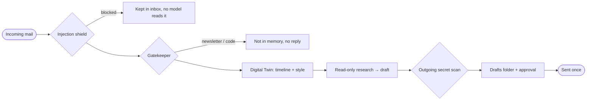

# ✉️ Digital Twin and Mail

> **Packages:** `internal/mail/` (engine), `internal/twin/` (store), `internal/autonomy/` (shield, decision engine, approval bridge, radar), bridged into `internal/app/` via `mail*.go`, `twin*.go`, `autonomy.go`, `approval_bridge.go`
> **Data:** `data/mail/accounts.json` (credentials in an encrypted vault), `data/twin/twin.db`
> **API endpoints:** `/api/mail/*` (16 routes), `/api/twin/{operation}`, `/api/twin/events`
> Full pages: `docs/DIGITAL_TWIN_AND_MAIL.md`, `docs/MAIL_SECURITY.md`, `docs/DIGITAL_TWIN_APPROVAL.md`

Memo can read your mail, protect you from it, and answer it in your own style — and it sends nothing without your say-so unless you tell it to. **Everything here is off by default.**

## Connecting
Gmail and Outlook sign in through OAuth (XOAUTH2, no app passwords); any other provider works with IMAP/SMTP and settings found from built-in presets or Thunderbird's autoconfig database. The IMAP client is Memo's own, with no extra dependency. A **60-second watcher** polls in the background; only mail that arrives after you connect is handled (a high-water mark), so an old inbox never floods the model.

## Triage — the Gatekeeper
Three layers, cheapest first: (1) structured data and your contacts (invitations, flights, invoices, one-time codes, people you write to, active reply threads); (2) standard headers (`List-Unsubscribe`, `Auto-Submitted`, `Precedence`, `noreply`-style senders); (3) a model, only for what is left. Five categories come out; bulk, newsletter and one-time-code mail never enter [[RAG and Semantic Memory|memory]] or get a reply.

## Protection
- **Inbound shield:** deterministic English and Turkish instruction-override, role-delimiter and base64 checks run before triage, memory indexing and calendar extraction. An optional decision-model review adds a second opinion and **fails closed**. Blocked mail stays readable in the inbox.
- **Mail is data:** it reaches a model only inside an untrusted-data envelope, and the research assistant has four read-only tools (contact history, memory search, calendar availability, git status of a registered project).
- **Outbound scan:** subject, body, `To`/`Cc` and drafts are checked for API keys, private keys, `KEY=value` lines and recent one-time codes before any connection opens.
- **Privacy wall:** the model sees only masked free/busy ranges, never event titles, places or guests.

## The twin
- **One person, every channel:** link a person's mail address and [[WhatsApp Integration|WhatsApp]] number for one timeline with original dates. People are never merged by name alone.
- **Your style:** a plain summary from your last 100 *sent* messages — not a trained clone.
- **Prepared replies:** a draft in your style goes to the Drafts folder and to **Mail → Replies**; a separate **reply model** writes it, the decision model only scores.
- **Per-person policy:** `never` / `draft_only` (default) / `full_auto`.
- **Approval anywhere:** in the app, or on WhatsApp and [[Telegram Integration|Telegram]] with `#onay N`, `#iptal N`, `#asla N` (only your own chat is accepted).
- **Automatic sending:** a **60-second** undo window, every rule re-checked at the moment of sending plus an independent score of at least 0.95; groups and CC never answered, nothing sent twice, mail older than six hours never answered on its own, one automatic reply per person per hour, and after a restart whatever still waits returns to you.
- **Calendar-aware:** `.ics` invitations are added with a review note, clashes flagged, up to two alternatives offered — without revealing other events.
- **Follow-up radar:** review-only reminder drafts for answers you are waiting on, plus tracking of your own dated promises.
- **Chat tools:** pending drafts, commitments, a contact's timeline, unfinished project work; `/mail` and `/twin` in the terminal.

See also [[Daily Briefing]] and [[Setup Wizard]].
