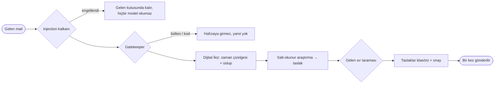

# ✉️ Dijital İkiz ve Mail

> **Paketler:** `internal/mail/` (motor), `internal/twin/` (depo), `internal/autonomy/` (kalkan, karar motoru, onay köprüsü, radar); `internal/app/` içinde `mail*.go`, `twin*.go`, `autonomy.go`, `approval_bridge.go` ile bağlanır
> **Veri:** `data/mail/accounts.json` (kimlik bilgileri şifreli kasada), `data/twin/twin.db`
> **API endpoint'leri:** `/api/mail/*` (16 rota), `/api/twin/{işlem}`, `/api/twin/events`
> Tam sayfalar: `docs/DIGITAL_TWIN_AND_MAIL.md`, `docs/MAIL_SECURITY.md`, `docs/DIGITAL_TWIN_APPROVAL.md`

Memo mailini okuyabilir, seni ondan koruyabilir ve senin üslubunla yanıtlayabilir; sen söylemedikçe hiçbir şey göndermez. **Buradaki her şey varsayılan olarak kapalıdır.**

## Bağlanma
Gmail ve Outlook OAuth ile (XOAUTH2, uygulama şifresi yok) girer; diğer her sağlayıcı IMAP/SMTP ile çalışır ve ayarlar hazır listeden ya da Thunderbird autoconfig veritabanından bulunur. IMAP istemcisi Memo'nun kendisidir, ek bağımlılık yok. **60 saniyelik izleyici** arka planda yoklar; yalnız bağlandıktan sonra gelen mail işlenir (yüksek-su-işareti), yani eski gelen kutusu modeli asla boğmaz.

## Sınıflandırma — Gatekeeper
Üç katman, en ucuzdan başlayarak: (1) yapısal veri ve kişilerin (davetler, uçuşlar, faturalar, tek kullanımlık kodlar, yazıştığın kişiler, süren yanıt zincirleri); (2) standart başlıklar (`List-Unsubscribe`, `Auto-Submitted`, `Precedence`, `noreply` benzeri göndericiler); (3) yalnız geriye kalanlar için bir model. Beş kategori çıkar; toplu, bülten ve tek kullanımlık kod mailleri [[RAG ve Semantik Hafıza|hafızaya]] girmez ve yanıt almaz.

## Koruma
- **Gelen kalkanı:** belirleyici İngilizce ve Türkçe talimat-ezme, rol-ayırıcı ve base64 denetimleri; sınıflandırmadan, hafızaya indekslemeden ve takvim çıkarımından önce çalışır. İsteğe bağlı karar modeli incelemesi ikinci görüş ekler ve **hata durumunda kapalı kalır**. Engellenen mail gelen kutusunda okunabilir kalır.
- **Mail veridir:** modele yalnız güvenilmeyen veri zarfı içinde ulaşır; araştırma asistanının dört salt-okunur aracı vardır (kişi geçmişi, hafıza araması, takvim doluluğu, kayıtlı projenin git durumu).
- **Giden tarama:** konu, gövde, `To`/`Cc` ve taslaklar, bağlantı açılmadan önce API anahtarları, özel anahtarlar, `ANAHTAR=değer` satırları ve yakın zamanda görülen tek kullanımlık kodlar için denetlenir.
- **Gizlilik duvarı:** model yalnız maskeli boş/dolu aralıkları görür; etkinlik başlığı, yer ya da konuk asla.

## İkiz
- **Tek kişi, her kanal:** bir kişinin mail adresini ve [[WhatsApp Entegrasyonu|WhatsApp]] numarasını bağla; orijinal tarihlerle tek zaman çizelgesi. Kişiler yalnız ada bakılarak asla birleştirilmez.
- **Üslubun:** son 100 *gönderdiğin* mesajdan düz bir özet; eğitilmiş bir klon değil.
- **Hazırlanan yanıtlar:** senin üslubunla bir taslak Taslaklar klasörüne ve **Mail → Yanıtlar**'a gider; metni ayrı bir **yanıt modeli** yazar, karar modeli yalnız puanlar.
- **Kişi başı politika:** `never` / `draft_only` (varsayılan) / `full_auto`.
- **Her yerden onay:** uygulamada ya da WhatsApp ve [[Telegram Entegrasyonu|Telegram]]'da `#onay N`, `#iptal N`, `#asla N` (yalnız kendi sohbetin kabul edilir).
- **Otomatik gönderim:** **60 saniyelik** geri alma süresi, gönderim anında her kural yeniden denetlenir ve en az 0,95'lik bağımsız puan aranır; gruplara ve CC'ye asla otomatik yanıt verilmez, hiçbir şey iki kez gitmez, altı saatten eski maile kendiliğinden yanıt verilmez, kişi başına saatte en çok bir otomatik yanıt gider ve yeniden başlatmadan sonra bekleyen her şey sana döner.
- **Takvimden haberdar:** `.ics` davetleri incelemen için bir notla eklenir, çakışma işaretlenir, en çok iki alternatif sunulur; diğer etkinlikler açığa vurulmaz.
- **Takip radarı:** beklediğin yanıtlar için yalnız incelemeye açık hatırlatma taslakları ve tarihli kendi sözlerinin takibi.
- **Sohbet araçları:** bekleyen taslaklar, taahhütler, bir kişinin zaman çizelgesi, projelerin yarım işleri; terminalde `/mail` ve `/twin`.

Ayrıca bkz. [[Günlük Brifing]] ve [[Kurulum Sihirbazı]].
